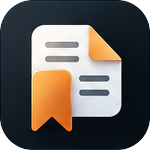

# Pagemark

A private, fully local book tracker for Android (iOS planned): log what you read and listen to, rate it, and keep your thoughts — with nothing leaving your phone unless you choose.



## Features

- **Log any book**: print, e-book or audiobook, any genre; several reads per book, half-star ratings, private thoughts.
- **Fast capture**: search Open Library, paste or scan an ISBN barcode, or add by hand. Free book data and covers, no key needed.
- **Track progress**: current page, progress bars, pages per day, days left; yearly goal ring; stats dashboard.
- **Organise**: shelves, series with numbers, tags, filters, sort, "Currently reading" strip.
- **Locked library**: PIN (attempt limits + recovery code) or fingerprint; re-locks on background; blocks screenshots.
- **Your data, your files**: CSV/JSON export; whole-database export with optional passphrase encryption.
- **Backups**: scheduled, verified, optionally encrypted backups to *your own* Google Drive; safe restore.
- **Themes**: light/dark in two palettes, with smooth transitions.
- **Updates**: in-app updater with release notes and an offline version history.

## Documentation

| | |
|---|---|
| [User Manual](docs/release-package/USER_MANUAL.md) | Every feature, step by step ([PDF](docs/release-package/Pagemark-User-Manual.pdf)) |
| [Install Manual](docs/release-package/INSTALL_MANUAL.md) | Download, install, update, build from source ([PDF](docs/release-package/Pagemark-Install-Manual.pdf)) |
| [Release Notes](docs/release-package/RELEASE_NOTES.md) | What changed in each version ([PDF](docs/release-package/Pagemark-Release-Notes.pdf)) |
| [Package Overview](docs/release-package/PACKAGE_OVERVIEW.md) | Simple / medium / advanced description ([PDF](docs/release-package/Pagemark-Package-Overview.pdf)) |
| [Drive backup setup](docs/DRIVE_SETUP.md) | One-time free Google Cloud setup |

## Install

Download the **arm64** APK from the [Releases page](https://github.com/AxialForge/Pagemark/releases), open it, and allow installs from your browser/Files app when asked. Android 7.0 or newer. Later updates: **Settings → Updates**.

## Build from source

```bash
flutter pub get
dart run build_runner build --delete-conflicting-outputs
flutter analyze && flutter test
flutter build apk --release --split-per-abi
```

Flutter 3.47+, Android SDK, JDK 17+. On Windows with JDK 25 see the loopback note in [CLAUDE.md](CLAUDE.md) (Gotchas).

## Privacy

No accounts, analytics or ads. The network is used for book lookup (Open Library), the update check (GitHub Releases) and — only if you set it up — Drive backup. Details in the User Manual, §16.

## Development

Architecture, conventions and every hard-won gotcha are in [CLAUDE.md](CLAUDE.md). Planned work is in [docs/ROUNDING_OUT_REPORT.md](docs/ROUNDING_OUT_REPORT.md).

Book data and covers: [Open Library](https://openlibrary.org).
