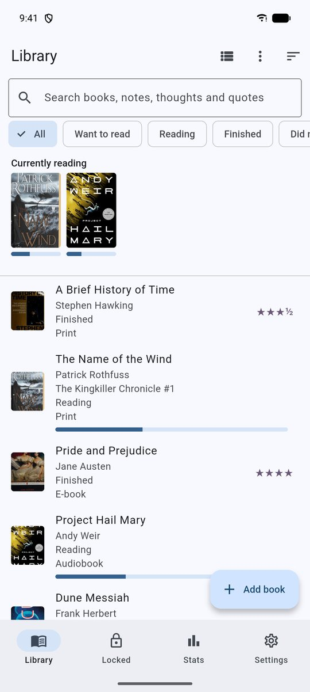

# Pagemark — Install Manual

**Version 0.4.2** · Android

---

## 1. Requirements

- An Android phone or tablet running **Android 7.0 (API 24) or newer**.
- About **100 MB** free storage (the app is ~30 MB; the library and cached covers are small).
- Optional, for specific features: a camera (barcode scanning), a screen lock or fingerprint (locked library), a Google account (Drive backup), an internet connection (book lookup, updates, backup).

## 2. Download

Releases are published at **https://github.com/AxialForge/Pagemark/releases**. Open the newest release and pick **one** APK:

| File | Use it on |
|---|---|
| `Pagemark-x.y.z-arm64.apk` | Almost every phone from the last ~8 years (64-bit ARM). **Choose this one** unless it fails to install. |
| `Pagemark-x.y.z-armv7.apk` | Older 32-bit phones. |

Not sure? Download the arm64 file. If Android says the app isn't compatible, use the armv7 one.

## 3. Install

1. Open the downloaded `.apk` (from your browser's downloads or the Files app).
2. Android will say your browser/Files app isn't allowed to install apps. Tap **Settings** and turn on **Allow from this source**, then go back.
3. Tap **Install**, then **Open**.

Pagemark is signed with the author's key, so future updates install over it and keep your data.

> Play Protect may show "unrecognised app" because Pagemark isn't distributed through the Play Store. Choose **Install anyway** (or **More details → Install anyway**).

## 4. First run

Pagemark opens on an empty Library. Tap **Add book** to start. Allow the **camera** only if you want to scan barcodes; everything else needs no permissions. In **Settings** you can pick a theme and read **About**.

<div class="shots one"><figure><figcaption>Pagemark with a few books added</figcaption></figure></div>


### Permissions Pagemark asks for

| Permission | Why |
|---|---|
| Internet | Book lookup (Open Library), update check (GitHub), optional Drive backup |
| Camera | Scanning ISBN barcodes (asked only when you open the scanner) |
| Biometric | Fingerprint/device unlock for the locked library |
| Install packages | Lets Android offer to install a downloaded update |
| Background work / network state | Running the scheduled Drive backup |

Pagemark does not ask for storage, photo/media or notification permissions.

## 5. Updating

**In the app:** Settings → **Updates** → *Download & install*. Android asks once to allow installs from Pagemark. You can also let it check once a day automatically.

**By hand:** download the newer APK from Releases and open it — it installs over the old version.

Your library, shelves, settings and PIN are all kept. **Make a backup first** if the library matters to you (Settings → Export database file, or Drive backup).

## 6. Uninstalling — read this first

Uninstalling Pagemark **deletes your library** from the phone (Android's own backup is disabled on purpose). Before you uninstall or switch phones:

1. Settings → **Export database file** (set a passphrase) and keep the file safely, **or** make sure a Google Drive backup is current.
2. On the new phone, install Pagemark and use **Restore** — a backup from an older Pagemark version restores fine; one from a newer version does not.

The PIN is not stored in backups. After restoring, set a new PIN for the locked library.

## 7. Setting up Google Drive backup (optional, free)

Needs a one-time Google Cloud project because Google requires every app that uses Drive to be registered. Follow **`docs/DRIVE_SETUP.md`** in the repository (enable the Drive API, create an Android OAuth client with package `com.axialforge.pagemark` and your signing key's SHA-1, create a Web client, copy its Client ID into Pagemark, and publish the consent screen).

For the official release APK, the signing-key SHA-1 is:

`39:04:59:AD:24:0F:35:99:4B:CD:A5:86:81:AF:9C:21:8C:FD:27:F7`

## 8. Building from source (developers)

```bash
git clone https://github.com/AxialForge/Pagemark.git
cd Pagemark
flutter pub get
dart run build_runner build --delete-conflicting-outputs   # regenerates lib/db.g.dart
flutter analyze && flutter test
flutter build apk --release --split-per-abi
```

Requirements: Flutter 3.47+ (stable), Android SDK, JDK 17+.

**Windows with a very new JDK (25):** Gradle can fail with *"Unable to establish loopback connection"*. Create a short folder such as `C:\tmpj` and run the build with
`JAVA_TOOL_OPTIONS=-Djdk.net.unixdomain.tmpdir=C:/tmpj`.

**Signing:** create a keystore, put its path and passwords in `android/key.properties` (this file is git-ignored — never commit it). Without it, release builds fall back to the debug key, which can't upgrade a release install.

## 9. Troubleshooting

| Symptom | Fix |
|---|---|
| "App not installed" | A different signing key is already installed (e.g. a debug build). Back up, uninstall, install the release APK. |
| "There was a problem parsing the package" | The download was cut off or you picked the wrong architecture; re-download or use the other APK. |
| Install blocked | Allow "install unknown apps" for the app you opened the APK from. |
| Update says "No public releases found" | Check connection; the project's releases must be public. |
| Fingerprint option missing | Set a screen lock/fingerprint in Android settings first. |
| Scanner is black | Allow the camera permission in Android → Apps → Pagemark. |
