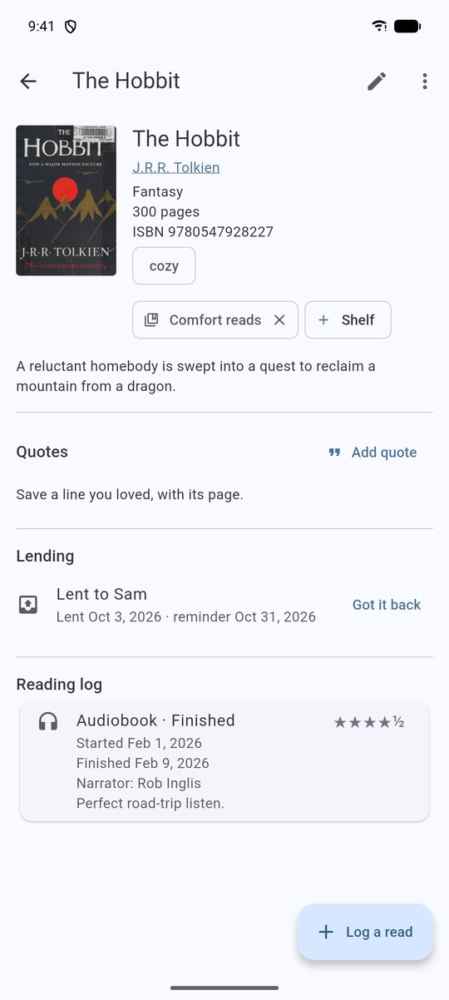
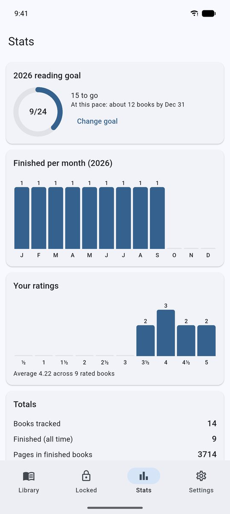

# Pagemark — Package Overview

**Version 0.6.0** · for readers outside the project. Three tiers: read the first for the idea, the second for what it does, the third for how it works.

---

# Tier 1 — Simple

**What it is.** Pagemark is an app for your phone that keeps a diary of the books you read and listen to. For each book you note what you thought, give it a star rating, and track how far you've got. You can look books up by title or by scanning the barcode on the back.

**What it's for.** Remembering. Which book was that? Did I like it? When did I finish it? It works for any kind of book — fantasy, romance, science, anything — and for audiobooks as well as print.

**What makes it different.**
- It is **private**. Everything stays on your phone. There's no account to make and nobody collects your reading habits.
- It has a **hidden shelf** for books you'd rather keep to yourself, locked with a PIN or your fingerprint.
- It's **free**, and it uses only free sources for book information.

**How you'd use it.** Install it, tap *Add book*, scan or search, and start logging. Once a year, glance at the *Stats* tab to see how you did.

---

# Tier 2 — Medium

**Purpose.** A local-first reading tracker for Android (iOS planned). It replaces cloud services such as Goodreads with a log you fully own, including audiobooks and a private vault.

**Main capabilities**

| Area | What you get |
|---|---|
| Capture | Search Open Library, look up by ISBN, scan barcodes, add manually; duplicate warning |
| Logging | Multiple *reads* per book (print / e-book / audio); status, dates, half-star rating, private thoughts, narrator, time |
| Progress | Current page, progress bars, pages per day, estimated days left |
| Organise | Shelves (many per book), series with numbers, tags, filters, sort, "Currently reading" strip |
| Library looks | Classic list, cover wall, bookshelf, book spines, compact — switchable, remembered per library |
| Insight | Yearly goal ring with pace forecast, books per month, rating spread, top genres/authors, totals |
| Privacy | Locked library (PIN with attempt limits and recovery code, or device biometrics), auto-relock, screenshot blocking |
| Quotes & covers | Save passages with pages; save covers on the phone for offline use and backups; author pages; series totals; optional private heat/content fields |
| Import | Goodreads, StoryGraph and Pagemark files, with a preview, duplicate handling, a safety copy and Undo |
| Bulk actions | Multi-select (finish, shelve, lock, trash) and swipe actions, all undoable |
| Data portability | CSV and JSON export of the main library; whole-database export, optionally passphrase-encrypted |
| Backup | Scheduled, verified backups to the user's own Google Drive; optional AES-256 encryption; safe restore with automatic safety copy |
| Care | Trash with 30-day recovery, in-app updates with release notes, offline version history, diagnostics log |
| Look | Six named themes (Harbor, Midnight Ink, Rosewater, Plum Velvet, Sage, Lamplight), animated transitions |

<figure><figcaption>Library</figcaption></figure><figure><figcaption>Book page</figcaption></figure><figure><figcaption>Stats</figcaption></figure>

**Principles.** No accounts, no analytics, no ads, no paid services. The network is used for exactly three things: book lookup (Open Library), update checks (GitHub Releases), and — only if configured — Drive backup.

**Who it's for.** Readers who want a durable, private record; people leaving other tracking sites; anyone who wants their data in a plain file they can open elsewhere.

**Distribution.** Free APKs on GitHub Releases (MIT-licensed source in a public repository). In-app updates install over the old version and keep your data.

---

# Tier 3 — Advanced

## Stack
Flutter (Dart) app; **Drift** over **SQLite** for storage; plain `StatefulWidget`s with database streams (no state-management package); `flutter_secure_storage` for secrets; `cryptography` for PBKDF2 and AES-GCM; `workmanager` for scheduled backup; `google_sign_in` + `googleapis` (Drive v3, `drive.appdata` scope) for backup; `http` for Open Library and GitHub; `mobile_scanner` for barcodes; `local_auth` for biometrics.

## Data model (schema 3)
- `books` — catalog entry: title, author, ISBN-13, cover URL, genre, series, `seriesNumber`, publisher, year, pages, description, tags, notes, `locked`, `added`, `deletedAt` (soft delete).
- `reads` — one read-through: format, status, started/finished, rating (0.5–5), thoughts, narrator, minutes, `currentPage`; FK to `books` with cascade.
- `shelves`, `book_shelves` — many-to-many.
- Indexes on `reads.bookId`, `books.locked`, `books.title`. WAL journal, 5 s busy timeout, `foreign_keys=ON` in `beforeOpen`. Versioned migrations (1→2→3) covered by a migration test.

## Privacy and security design
- **Vault is a flag, not a second database**, enforced at every read path: library queries, Stats, Trash, duplicate check and CSV/JSON export all filter on `locked`. Full DB exports/backups include it by design and can be encrypted.
- **PIN:** PBKDF2-HMAC-SHA256, 150 000 iterations, random 16-byte salt, constant-time compare, persistent attempt counter with exponential lockout (30 s doubling, cap 1 h). One-time recovery code stored only as a PBKDF2 hash. v0.1.0 hashes upgrade on first successful unlock.
- **Vault lifecycle:** on background/leave the app pops locked routes, empties the locked-cover cache and deletes temporary exports; `FLAG_SECURE` is set while the vault is open and kept until resume so the recents thumbnail is blank.
- **Backups:** container `PGMKENC1 | salt | nonce | AES-256-GCM ciphertext | tag`, key from PBKDF2 (150 k). Drive upload is skipped when the plaintext digest is unchanged, size-verified before older copies (newest 5 kept) are pruned. The passphrase lives in secure storage so the background isolate can encrypt unattended.
- **Restore:** open candidate read-only, `PRAGMA integrity_check`, require `books`/`reads`, reject newer schemas, snapshot current DB (newest 3 kept), close connection, delete `-wal/-shm`, rename staged copy into place; app restarts.
- **Android:** `allowBackup=false` plus data-extraction rules exclude everything; no analytics SDKs.

## Networking
Open Library search/ISBN/works endpoints with an identifying User-Agent, retry with backoff on 429/5xx/timeouts, per-record fault tolerance, ISBN-10→13 normalisation and checksum validation. Updates use the unauthenticated GitHub releases API: newest-first release list → APK chosen by ABI → streamed download with size and SHA-256 (from the release asset's digest) verification → system installer via `open_filex`. Same signing key ⇒ in-place upgrade.

## Quality and process
- 187 automated tests: database behaviour, migration from v1, restore validation, export safety (formula neutralisation, BOM), encryption round-trip and tamper detection, lock service (lockout, recovery, legacy upgrade), lookup parsing/retries (mock HTTP), updater logic, and widget tests for custom UI.
- GitHub Actions CI: analyze, tests, generated-code check, debug build. Signed release APKs are built locally; the keystore never leaves the owner's machine.
- Release flow: version bump + `CHANGELOG.md` in one commit → tag `vX.Y.Z` → APKs (`arm64`, `armv7`) attached to a GitHub Release. The changelog ships inside the app as an asset.

## Known limits (0.6.0)
- Database is not encrypted at rest on the phone (SQLCipher is on the roadmap); saved covers are plain files in app storage.
- Scheduled backups depend on Android's WorkManager timing; OEM battery managers can delay them. No failure notification yet.
- No iOS build yet (project is configured; needs a Mac to build and sign).
- Release builds are not minified (size/safety trade-off pending device testing).

## Roadmap highlights
Goodreads/StoryGraph import, grid cover view, quotes and highlights, series entity with total volumes, SQLCipher, backup failure notifications, iOS.
