# Pagemark — User Manual

**Version 0.8.0** · A private, fully local book tracker for Android

*Screenshots show sample books and were captured from the Android app (0.7.0).*

---

## 1. What Pagemark is

Pagemark is a reading log that lives only on your phone. You record what you read or listen to — print, e-book or audiobook, any genre — with your rating, dates, progress and private thoughts. Book details and cover art come from the free **Open Library**; everything you write stays on your device unless you choose to export or back it up.

There is no account, no server and no tracking. The only times Pagemark uses the internet are: looking up a book, checking for an app update, and nothing else.

## 2. The four tabs

| Tab | What it is |
|---|---|
| **Library** | Your books. Search, filter, sort, shelves, series — in five looks. |
| **Locked** | A private library behind a PIN and/or your fingerprint. |
| **Stats** | Your reading goal and charts. |
| **Settings** | Themes, updates, export, backup, privacy, trash, diagnostics. |

A small dot on **Settings** means an app update is waiting.

<figure><figcaption>Library</figcaption></figure><figure>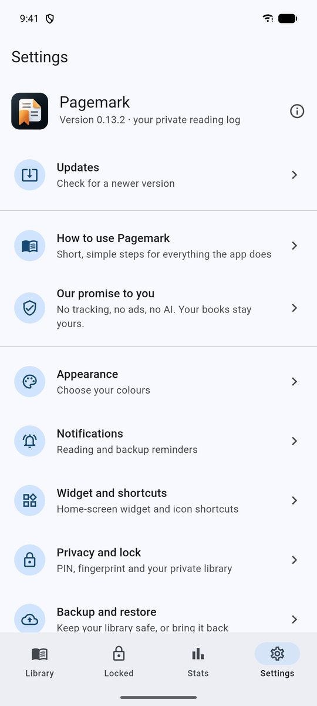<figcaption>Settings</figcaption></figure><figure>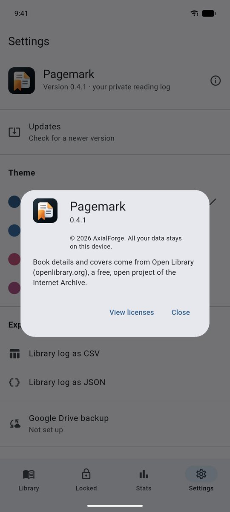<figcaption>About</figcaption></figure>

## 3. Adding a book

Tap **Add book** (bottom of the Library).

1. **Search** — type a title or author and press search. Tap a result to add it.
2. **By ISBN** — type or paste an ISBN into the same box and it is looked up directly. Invalid ISBNs are explained instead of searched.
3. **Scan** — tap the barcode icon at the top and point the camera at the ISBN barcode on the back cover. Only real book barcodes are accepted; the torch button helps in dim light.
4. **Manually** — if a book isn't found, choose **Add by hand** and enter a title; fill in the rest later with **Edit**.

If the book is already in the same library (same ISBN, or the same title and author) Pagemark warns you and offers to open the existing one. The main and locked libraries never compare against each other, so the main library can't reveal a locked title.

Results are ranked so real editions come first. Summaries, study guides and workbooks that Open Library also lists are tucked behind **Show N more results** (if every result is that kind of book, they are all shown).

Descriptions are fetched a moment after the book is saved when Open Library has one.

<figure>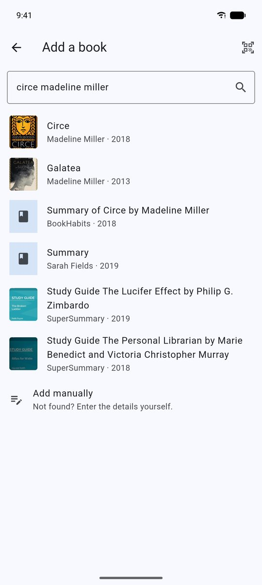<figcaption>Add a book: search results</figcaption></figure>

## 4. The book page

Tap a book to open it. You'll see the cover, details, tags and shelves, your notes, and the **Reading log**.

- **Edit** (pencil) — title, author, series and series number, genre, tags, publisher, ISBN, cover URL, year, pages, description and private notes.
- **⋮ menu** — move the book to or from the Locked library, or **Move to Trash**.
- **Log a read** — records a new read-through (see §5). A book can have many reads: a re-read, or a print copy and an audiobook of the same title.

### Shelves
Tap **+ Shelf** on a book to put it on any number of shelves ("Comfort reads", "Book club", "Lent out"). Create new shelves from there. Remove a book from a shelf by tapping the × on its chip.

<figure><figcaption>A finished book, with shelf and log</figcaption></figure>

### Series
In **Edit**, type the series name and the number in the series (decimals work: `2.5`). Rows show the badge, and the **Series** screen (Library ⋮ menu) groups your books, shows how many you've read, and names what's next. It knows only the books you've added, not how long the series really is.

<figure>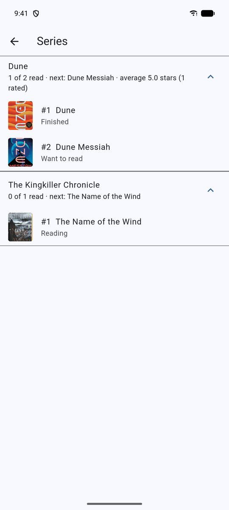<figcaption>Series screen</figcaption></figure><figure>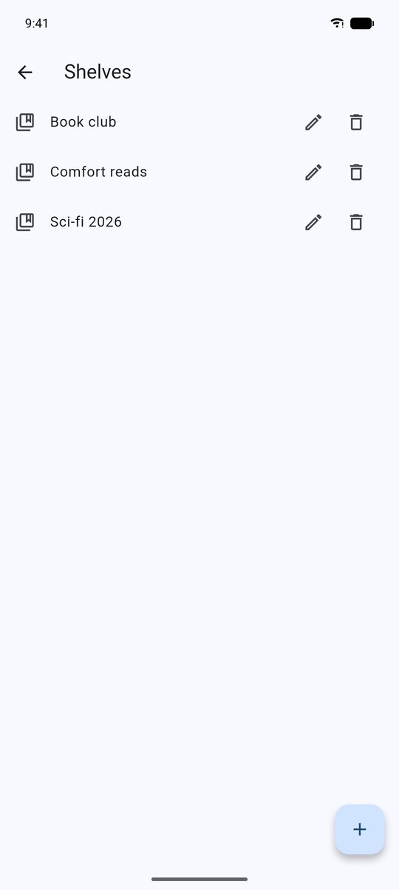<figcaption>Manage shelves</figcaption></figure>

## 5. Logging a read

Choose **Log a read** (or tap an existing read to edit it).

- **Format** — Print, E-book or Audiobook. Audiobooks add a **Narrator** field.
- **Status** — Want to read, Reading, Finished, or Did not finish.
  - Choosing *Finished* fills in today's date (change it if needed); choosing *Reading* or *Want* clears the finished date.
  - A finished date earlier than the start date is refused.
- **Started / Finished** — tap to pick a date; **Started today / yesterday** are quick chips.
- **Current page** — shown while *Reading*.
- **Rating** — tap stars. Tap the **left half** of a star for a half star, the right half for a whole one; tap the same value again to clear.
- **Time** — minutes read or listened.
- **Your thoughts** — free text, private.

Delete a read with the bin icon (you'll be asked to confirm).

### Reading progress
While a book has an active read, its page shows a **progress card**. Tap **Update progress** and enter the page you're on. If the book has a page count you get a progress bar, pages per day, and an estimate of days left at your pace. Reaching the last page offers to mark the read finished. Progress bars also appear on the Library list and in the **Currently reading** strip.

<figure>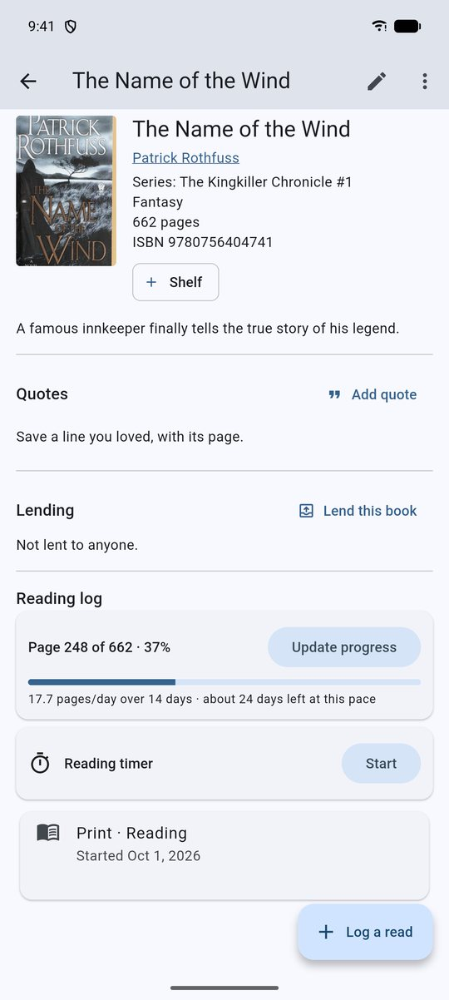<figcaption>Progress card</figcaption></figure><figure>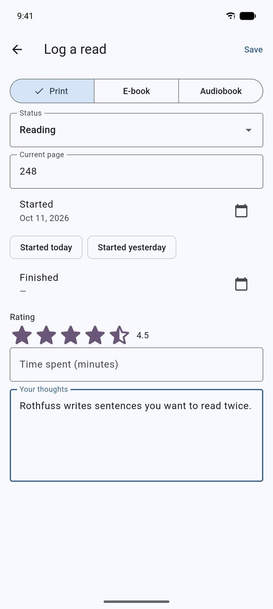<figcaption>Logging a read</figcaption></figure>

## 6. The Library

- **Search** — title, author, tags, genre and series.
- **Filters** — status chips (All / Want / Reading / Finished / DNF), format chips, and one chip per shelf. Tap a shelf chip again to clear it.
- **Sort** (⇅ icon) — Recently added, Title, Author, Rating.
- **Currently reading** — a strip of covers at the top when nothing is filtered.
- **Remembered** — your sort and filters are remembered separately for the main and locked libraries.
- **Ratings** show as stars (4.5 = ★★★★½) and average only your **finished** reads.
- **⋮ menu** — **Series** and **Manage shelves** (rename or delete shelves; deleting a shelf never deletes books).

<figure>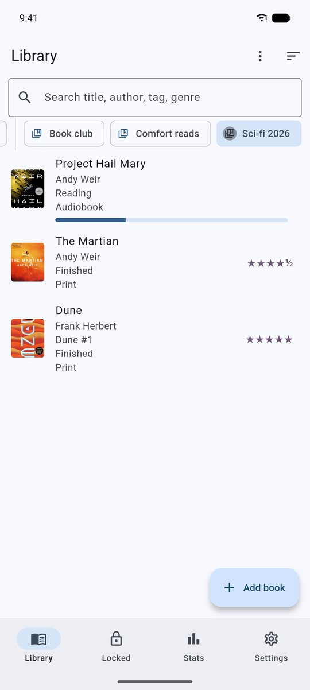<figcaption>Filtering by a shelf</figcaption></figure>

### Library styles

Tap the **style icon** at the top of the Library to choose how your books are drawn. The choice is remembered separately for the main and locked libraries, and the Library cross-fades between styles.

| Style | What it shows |
|---|---|
| **Classic** | A row per book: cover, title, series, status, format, rating and a progress bar |
| **Cover wall** | A grid of covers with rating stars and a progress strip; titles underneath |
| **Bookshelf** | Covers standing on wooden shelves, filled edge to edge; can be grouped under named shelves |
| **Spines** | Cloth-bound spines in natural binding colours with gold-leaf lettering and gilt bands; width follows the page count. A ribbon pokes out of the book you're reading and a small gold seal marks the ones you've finished. The author's surname joins the title when there is room |
| **Compact** | One tight line per book — the most books per screen |

<figure>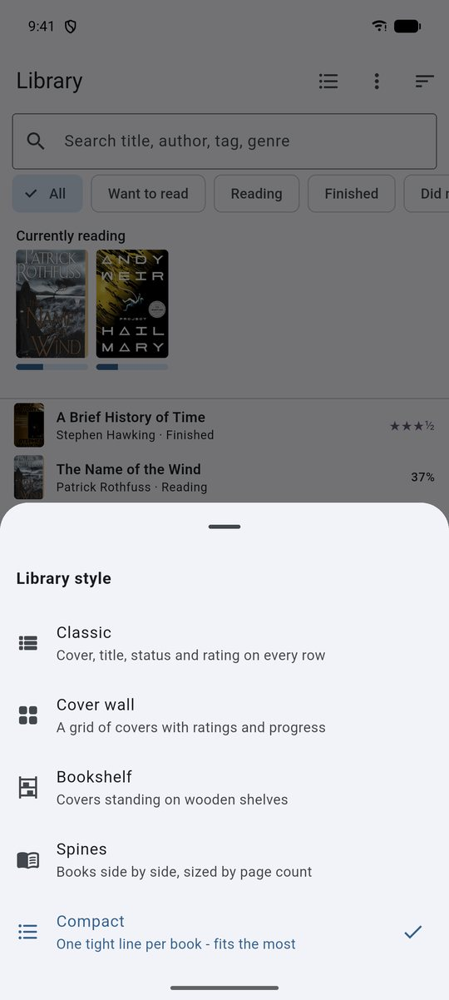<figcaption>Choosing a style</figcaption></figure><figure>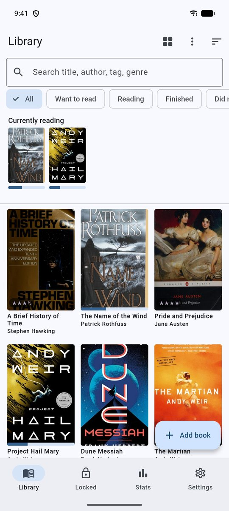<figcaption>Cover wall</figcaption></figure><figure>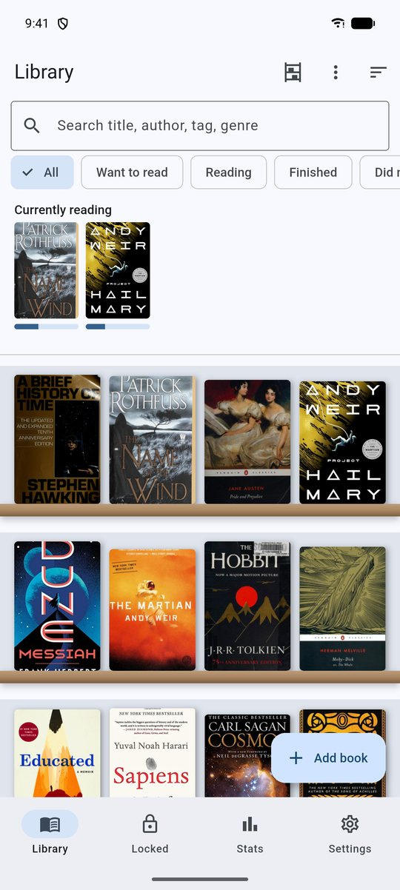<figcaption>Bookshelf</figcaption></figure>

<figure>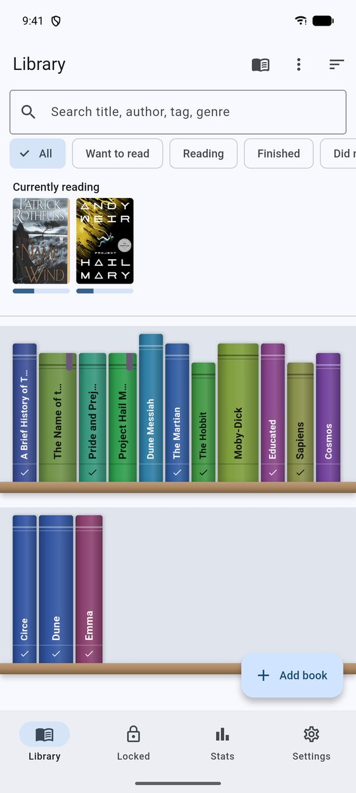<figcaption>Spines</figcaption></figure><figure>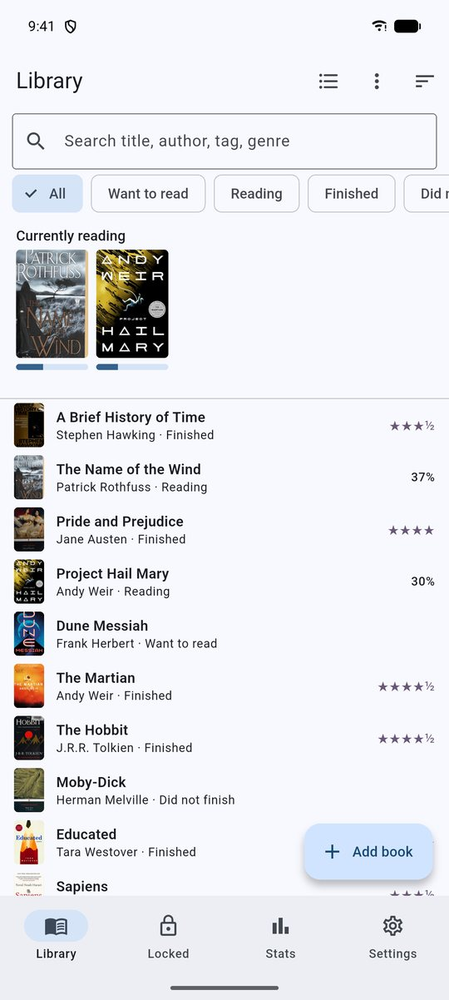<figcaption>Compact</figcaption></figure>

Filters, search, sort and shelves work the same in every style, and tapping any book opens its page.

#### Naming your shelves on the bookcase

In **Bookshelf** or **Spines**, open the style picker and switch on **Group by my shelves**. Each of your named shelves ("Comfort reads", "Book club" …) becomes its own wooden shelf under a brass **nameplate** showing its name and how many books it holds; books that aren't on any shelf collect under **Not on a shelf**. **Tap a nameplate to rename that shelf** — the new name appears everywhere (filters, the book page, Manage shelves). A book on two shelves stands on both. Create shelves from a book's page (**+ Shelf**) or **⋮ → Manage shelves**.

<figure>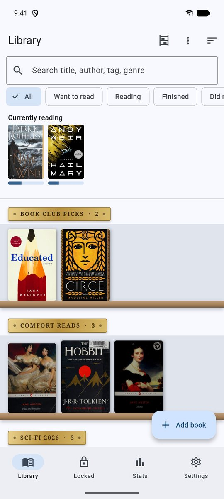<figcaption>Bookshelf grouped by shelf</figcaption></figure><figure>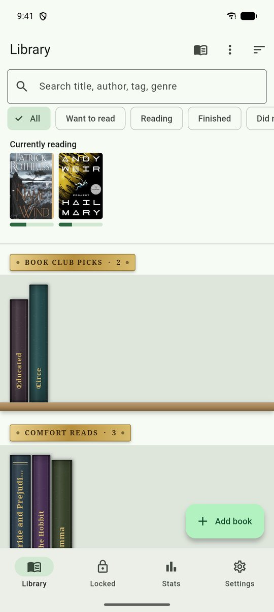<figcaption>Sage, with Spines grouped</figcaption></figure><figure>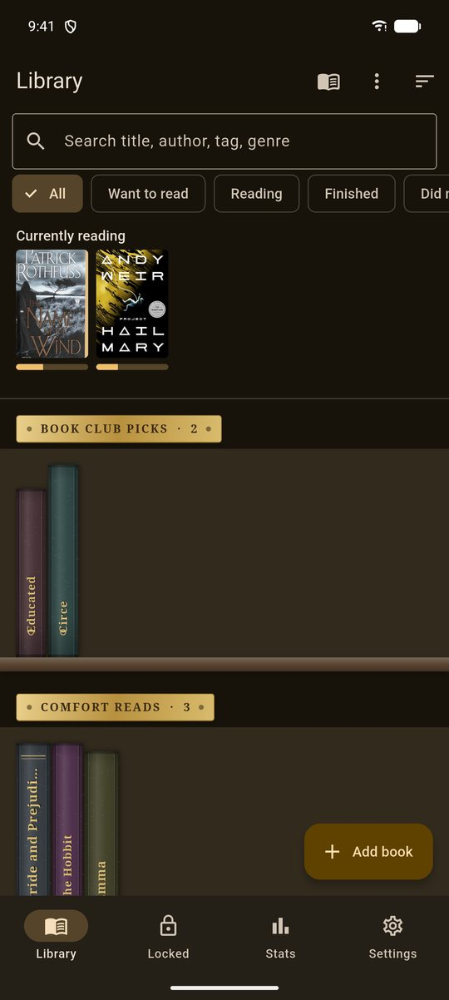<figcaption>Lamplight</figcaption></figure>

## 5b. Quotes, authors, covers and series

### Quotes

On a book's page, **Add quote** saves a passage with its page number and an optional note about why it stuck. Tap a quote to edit it; its ⋮ menu can **copy** or **share** it (as the quote followed by author, title and page) or **delete** it (with Undo). The Library search box also searches your quotes, so you can find a book by a line from it.

<figure>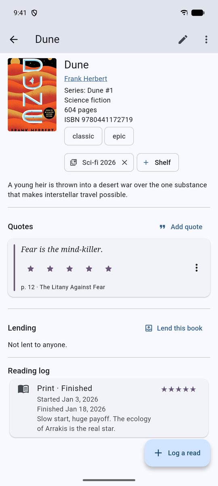<figcaption>Quotes on a book page</figcaption></figure><figure>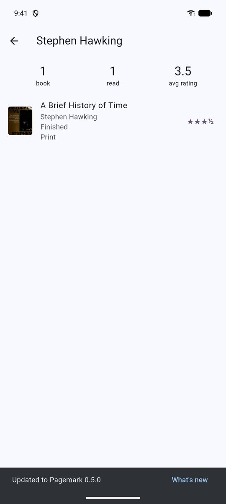<figcaption>An author page</figcaption></figure>

### Authors

Tap an author's name on a book to open their page: every book by them in this library, how many you've read and your average rating. (Locked books appear only inside the locked library.)

### Covers on your phone

By default covers load from the internet. From a book's ⋮ menu you can **Save cover on this phone** (so it works offline and travels in backups), **Choose cover from gallery**, or **Remove saved cover** (the web cover returns). **Settings → Covers** shows how many are saved and can save them all in one go, with a Stop button, and tidy unused files. Covers of locked books are saved too; they stay on the phone and are in backups, so protect backups with a password.

### Series totals

In **Edit**, **Books in the series** records how long the series is. The Series screen then says things like "2 of 7 read · 5 not in your library".

### Heat and content notes (optional)

Settings → Your library → **Heat level and content notes** adds two private fields to each read: a 0–5 flame rating and a content-notes line. They show on the book page, add a **Heat** chart to Stats, and are *left out* of CSV/JSON exports unless this switch is on. It is off by default.

## 6b. Selecting many books, and swiping

**Long-press** any book (in any Library style) to start selecting; **tap** other books to add or remove them. The bar at the top shows how many are selected and offers:

| Button | What it does |
|---|---|
| Select all | every book currently shown (respects your search and filters) |
| Double tick | **mark finished today**: the active read becomes Finished with today's date; books with no read get one |
| Shelf | add them all to a shelf (or make a new one) |
| Padlock | move them to the locked library (or, inside the vault, back to the main library) |
| Bin | move them to Trash |

Everything except "add to shelf" shows an **Undo** message afterwards. Press Back or the × to leave selection mode.

<figure>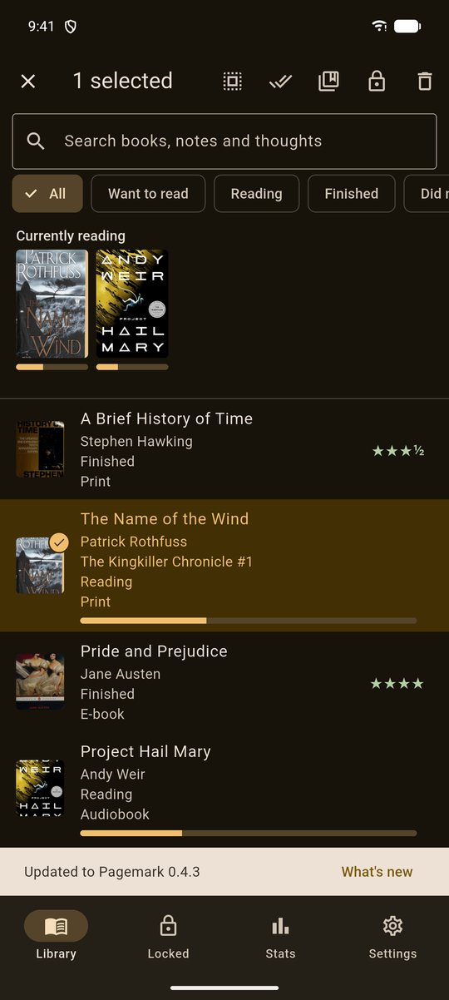<figcaption>A book selected, with the bulk-action bar</figcaption></figure>

In the **Classic** and **Compact** styles you can also **swipe a row right** to mark it finished today, or **swipe left** to move it to Trash (with Undo).

## 7. Stats

The Stats tab counts your **main library only** — locked books never appear in it.

- **Reading goal** — set how many books you want to finish this year. An animated ring shows progress, and Pagemark estimates how many you'll finish by 31 December at your current pace.
- **Finished per month** and **Your ratings** (how your ratings are spread, and your average).
- **Totals** — books tracked, finished, pages, logged time, average days to finish, and finished books by format.
- **Top genres** and **Top authors**.

<figure><figcaption>Goal and charts</figcaption></figure><figure>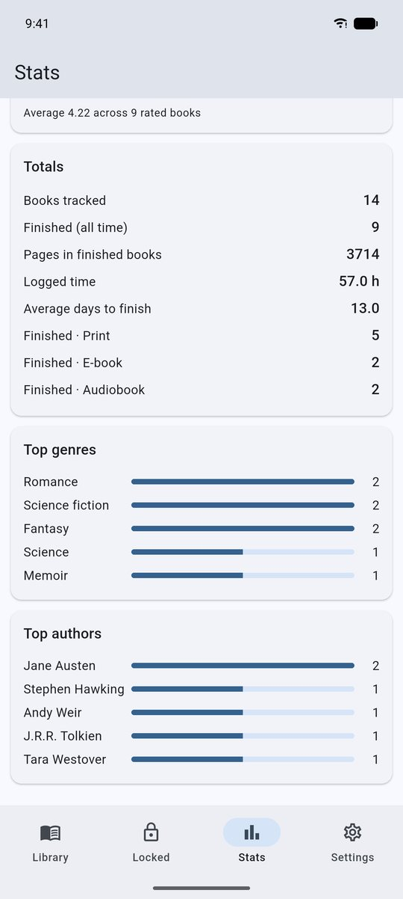<figcaption>Totals and rankings</figcaption></figure>

## 8. The Locked library

A second library for books you want kept private. Nothing in it shows in the main library, Stats, Trash, exports or searches.

### Setting up
Open the **Locked** tab the first time and choose:

- **Set a PIN** — 4 to 12 digits, entered twice. Pagemark then shows a **recovery code** once. **Write it down.** It is the only way back in if you forget your PIN.
- **Use fingerprint / device lock only** — uses your phone's screen lock. Needs a screen lock to be set up on the phone.

### Using it
Enter the PIN (or use the fingerprint button). Add books while the Locked tab is open, or move any book across with its ⋮ menu.

<figure>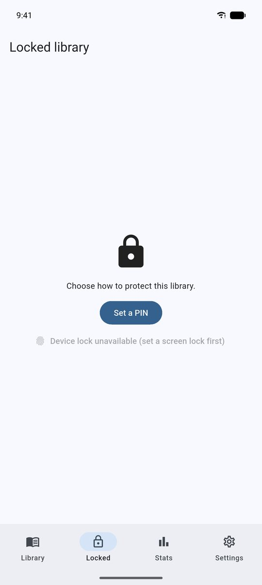<figcaption>First visit to the Locked tab</figcaption></figure>

### Lock the whole app, and how long it waits

Settings → Privacy and lock has two more options:

- **Lock after leaving the app** — *Immediately* (default), *After 1 / 5 / 15 minutes*. This is how long Pagemark may sit in the background before it asks again. It applies to the locked library and to the whole-app lock below.
- **Lock the whole app** — Pagemark asks for your PIN or fingerprint every time it opens, and when you return after the delay. It uses the same PIN as the locked library (turning it on walks you through setting one). While it is showing, screenshots and the app-switcher thumbnail are blocked, nothing can be opened over it, and Back leaves the app.

<figure>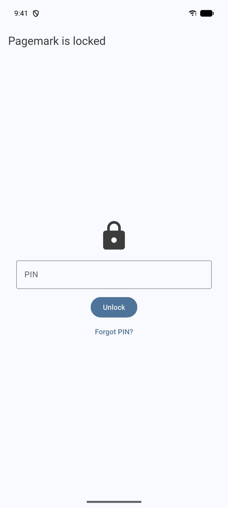<figcaption>The whole-app lock</figcaption></figure>

### Protection you can rely on
- **Wrong PINs are limited.** After 5 misses the PIN is locked out for 30 seconds, doubling after every further 5 misses (up to 1 hour).
- **It re-locks itself** when you leave the tab or put Pagemark in the background. Open locked screens close, locked covers are wiped from the image cache, and temporary export files, including the copies the share sheet and file picker keep, are deleted the next time Pagemark opens or the vault closes.
- **No screenshots.** While the vault is open the screen can't be captured and the app-switcher thumbnail is blank.
- **Changing the lock needs the lock.** Changing or removing the PIN asks for the current PIN (or your fingerprint first).

### Forgot your PIN?
On the lock screen tap **Forgot PIN?**, enter the recovery code and a new PIN. You'll receive a **new** recovery code; the old one stops working.

### Settings → Privacy and lock
**Lock now**, **Set or change PIN**, and **Remove lock** (which asks for the current PIN first; locked books stay in the locked library, and the whole-app lock switches off because it needs a PIN). If Android ever clears Pagemark's saved lock, the library stays closed until you confirm with your phone's screen lock and set a new PIN.

## 8b. Reminders, widget, sharing and shortcuts

**Reading reminder.** Settings → *Notifications* → **Daily reading reminder**. Android asks once for permission to send notifications. Pick the time; Pagemark schedules the next three weeks and tops them up every time you open it. The text never names a book. Android may deliver it a few minutes late when battery saver is on.

**Home-screen widget.** Long-press the home screen, choose *Widgets*, then *Pagemark*. It shows up to three books you are reading and your yearly goal, and opens Pagemark when tapped. It is fed from the main library only, so the locked library never appears. Turn off **Show book titles on the home-screen widget** to show counts instead; with the whole-app lock on it always shows counts, because a widget can be seen without unlocking.

**Share to Pagemark.** In any app, Share → Pagemark. An ISBN is looked up directly; a Goodreads or Open Library link is searched by the title in its address; other text is searched as typed. You land on *Add a book* with the results, and nothing is saved until you choose one.

**Shortcuts.** Long-press the Pagemark icon: **Add book** and **Reading now**.

## 9. Themes

Settings → **Appearance** offers six looks, each named for its mood:

| Theme | Mode | Feel |
|---|---|---|
| **Harbor** | Light | calm slate blue (the default) |
| **Midnight Ink** | Dark | deep blue-black |
| **Rosewater** | Light | soft rose |
| **Plum Velvet** | Dark | rich plum |
| **Sage** | Light | gentle library green |
| **Lamplight** | Dark | warm reading-lamp amber |

Your choice is remembered. The Library styles pick up the theme too: the bookcase wall, the spine colours and the rating stars all follow it.

<figure>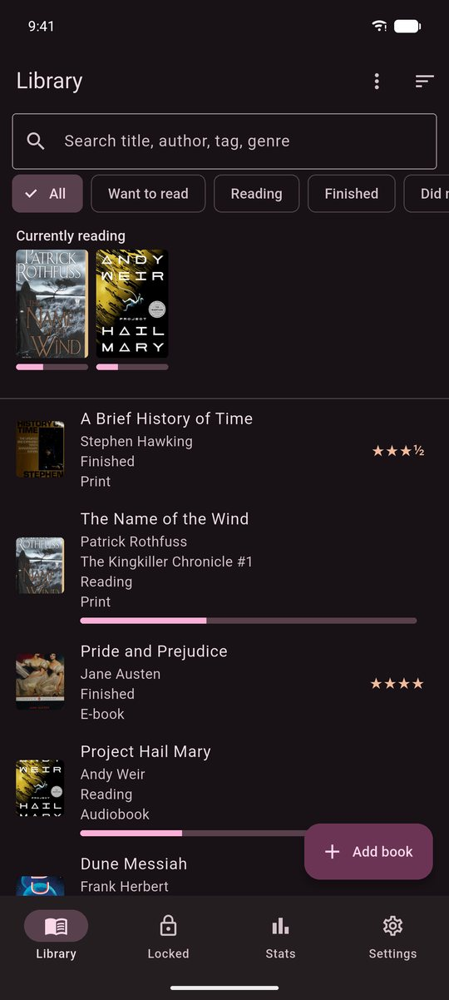<figcaption>Plum Velvet (dark)</figcaption></figure><figure>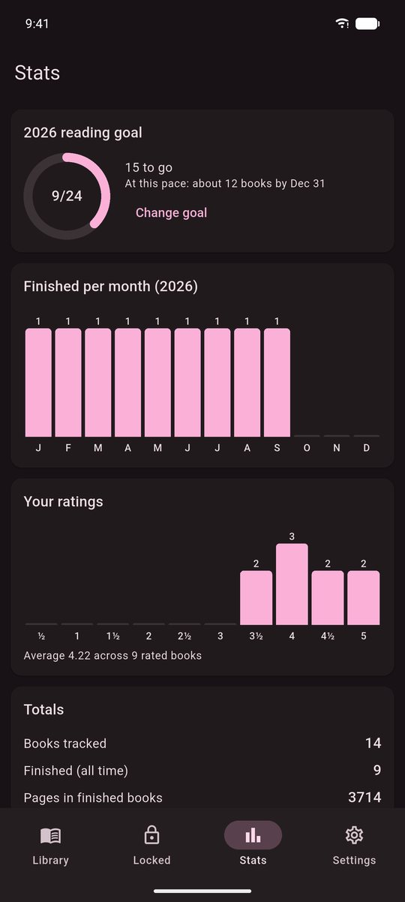<figcaption>Stats in the dark theme</figcaption></figure>

## 10. Exporting your data

Settings → Import and export (main library only — locked books are never included):

- **CSV** — opens in Excel, Numbers or Sheets (accents display correctly; cells that look like formulas are made safe).
- **JSON** — structured, with a format version.

Settings → Backup and restore (**includes locked books**):

- **Export database file** — a complete copy you can restore on another device. You'll be asked for a **password**; leave it empty only if you understand the file will be readable by anyone who gets it.
- **Restore from database file** — see §12.

## 10b. Importing your reading history

Settings → Import and export → **Bring in books from another app** brings books in from another app or from a Pagemark export:

- **Goodreads** — on the Goodreads website: My Books → Import and export → *Export Library*.
- **StoryGraph** — Manage Account → Manage Your Data → *Export*.
- **Pagemark** — a CSV or JSON file made by Settings → Import and export (also handy for moving to a new phone's main library).

Choose the file and Pagemark shows what it found: how many books and reads, how many are **new** and how many you **already have**, which shelves it would create, and any rows it had to skip (for example a row with no title). For books you already own you choose to **skip** them, **add the file's reads** to your existing entry, or import them as **separate copies**. Press **Import**: a safety copy of your library is saved first, and everything is added in one step — if anything goes wrong, nothing changes. Afterwards **Undo import** moves the new books to Trash.

<figure>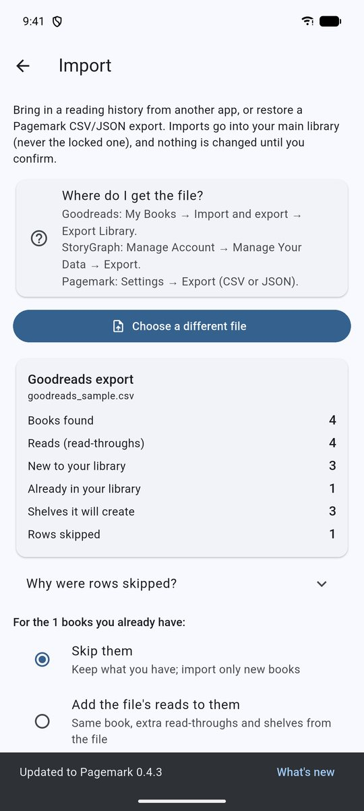<figcaption>What the file contains</figcaption></figure><figure>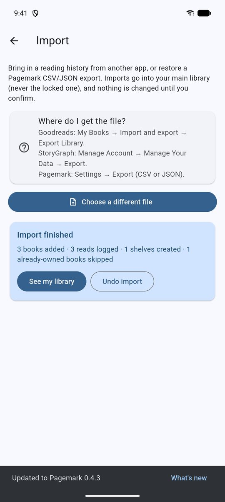<figcaption>After importing</figcaption></figure>

What gets mapped: statuses (read, currently reading, to-read, did-not-finish), ratings (rounded to the nearest half star), the date you finished, your review text, print / e-book / audiobook, ISBNs (so covers appear), and your Goodreads shelves become Pagemark shelves. Imports never touch the locked library, and "already have" only compares against your main library.

## 11. Backups

Settings → Backup and restore. The top of the page shows when you last saved a copy.

- **Save a copy as a file:** one file with your whole library, locked books included. Choose a **password** (recommended) and remember it: without it nobody can open the file, not even Pagemark. Keep the file somewhere other than this phone (email, Google Drive, a computer).
- **Save my list as a spreadsheet:** a list for Excel or Google Sheets. Locked books are not included.
- **Remind me to back up:** a notification every week, two weeks or month (your choice), counted from the last time you saved a copy. Android 13 and newer asks once for permission to send notifications.

## 12. Restoring

**From a file** (Settings → Backup and restore → Restore from a file) or **from Drive** (Backup page → Restore from Drive…):

1. Pick the backup. If it is encrypted you'll be asked for its password.
2. Pagemark checks it is a healthy Pagemark database from this or an older version, and tells you how many books and reads it holds.
3. It keeps a **restore point of your current library** (the newest 3 of each kind are retained inside the app), then replaces the library and asks you to close and reopen the app.

**Going back:** Settings → Backup and restore → **Go back to an earlier copy** lists the copies Pagemark kept before each restore and import. Tap one to restore it the same way.

If the backup holds locked books, Pagemark reminds you that your **PIN is not part of backups** — open the Locked tab and set a new PIN afterwards.

A damaged, foreign, or too-new file is rejected before anything changes.

## 13. Updates

Settings → **Updates** (or the dot on the Settings tab).

- Shows the version you have and whether a newer one exists, how many releases you're behind, the download size, and **what changed** in each.
- (Not in the Google Play version, where Play does the updating.) **Download & install** fetches the right file for your phone, checks its size and checksum, and opens Android's installer. The first time, Android asks you to allow installs from Pagemark. The update installs over the current app, so your library and settings are kept.
- **Check automatically** (on by default) does a quiet check at most once a day. The only thing sent is a request to GitHub for the release list. Switch it off any time.
- **What's new** shows every change in every release, offline. After an update, a **What's new** prompt links to it.

<figure>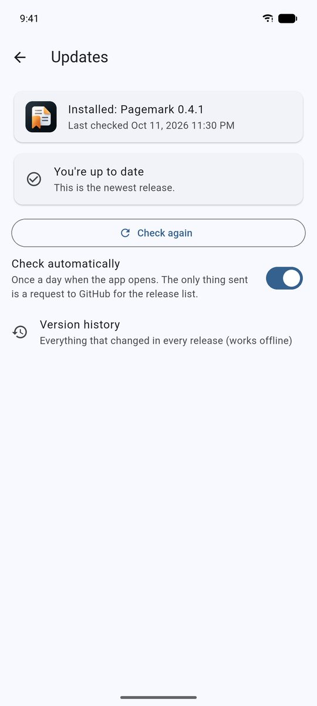<figcaption>Updates</figcaption></figure><figure>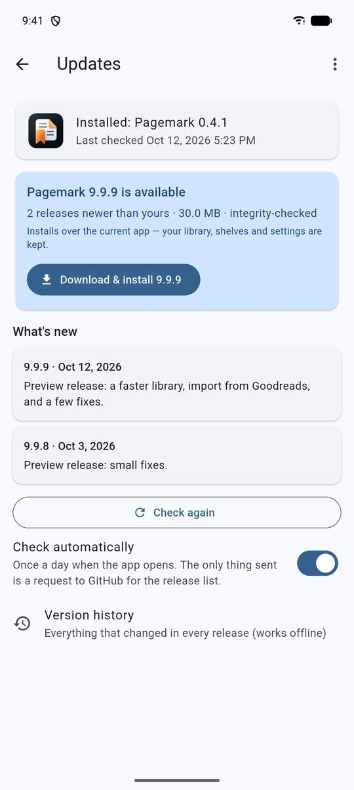<figcaption>When an update is waiting (sample data)</figcaption></figure>

## 14. Trash

Deleting a book moves it to **Settings → Your library → Deleted books**. Restore it, or delete it forever; anything left is removed automatically after **30 days**. Books deleted from the **locked** library have their own Trash: unlock the vault, then choose **⋮ → Trash**. They wait the same 30 days, and the main Trash never lists them.

## 15. Diagnostics

Settings → Help and about → **Problem report** shows a small rolling event log (errors, background backup runs, lookup problems). Database error details are removed before anything is written, so it does not keep your titles or thoughts. **Copy** it when asking for help; **Clear** it when done.

## 16. Your privacy, in plain terms

- Your library is stored only in a database file inside the app, and Android's own cloud backup is switched off for it.
- Pagemark sends **book searches** to Open Library and **update checks** to GitHub. Backups are saved only where you choose.
- Nothing is sent to the developer. There are no accounts, ads or analytics.
- Cover images are downloaded from Open Library and cached on the phone; locked covers use a separate cache that is cleared whenever the vault closes.

## 17. Troubleshooting

| Problem | What to do |
|---|---|
| Search says it couldn't reach Open Library | Check your connection and try again; Pagemark retries busy servers automatically. You can always **Add by hand**. |
| A scanned barcode does nothing | Only ISBN book barcodes (starting 978 or 979) are accepted. Try the torch, or type the ISBN. |
| Covers are blank offline | Covers are downloaded on demand and cached; they appear once they've loaded online. |
| Forgot the PIN and lost the recovery code | The locked library can't be opened — that is the point of the lock. Removing the lock also needs the PIN, and the PIN is not part of backups, so a restore won't help. Keep the recovery code safe. |
| Backup shows FAILED | Open the backup page for the message; also see Settings → Help and about → Problem report. |
| Update says no releases found | The project's releases page must be public. Check your connection. |
| "App not installed" during an update | Usually a different signing key (e.g. a debug build over a release build). Back up, uninstall, and install the release APK. |

## 18. Glossary

- **Read** — one read-through of a book (format, dates, rating, thoughts).
- **Shelf** — a free-form group of books; a book can be on many.
- **Locked library** — the PIN-protected second library.
- **Recovery code** — one-time code that resets a forgotten PIN.
- **ISBN** — the number on a book's barcode that identifies an edition.
